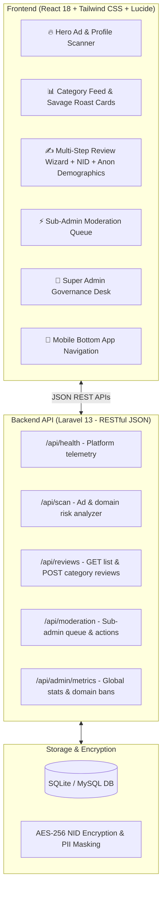

# 🔥 SavageTruth — The Uncensored Truth & Verification Network

[](https://laravel.com)
[](https://react.dev)
[](https://tailwindcss.com)
[](https://vitejs.dev)
[](LICENSE)

> **SavageTruth** is an eye-catching, ultra-modern, 100% mobile-friendly review and anti-scam intelligence platform designed to eliminate fake online reviews, protect consumers from deceptive sponsored social ads (Facebook, YouTube, TikTok), and provide transparent, evidence-backed accountability for **Doctors, Contractors, Individuals, Showrooms, and Retail Staff**.

---

## 📌 Table of Contents

- [Why SavageTruth?](#-why-savagetruth)
- [Key Core Capabilities](#-key-core-capabilities)
  - [1. Universal Category Review Engine](#1-universal-category-review-engine)
  - [2. Youth Hype & Savage "How Bad Is He? / Roast Meter"](#2-youth-hype--savage-how-bad-is-he--roast-meter)
  - [3. Anonymous Demographic Safeguard](#3-anonymous-demographic-safeguard)
  - [4. Account Age & Identity Authenticity Spectrum](#4-account-age--identity-authenticity-spectrum)
  - [5. Sub-Admin Moderation Queue](#5-sub-admin-moderation-queue)
  - [6. Super Admin Governance & Global Blacklist](#6-super-admin-governance--global-blacklist)
- [System Architecture](#-system-architecture)
- [Directory Structure](#-directory-structure)
- [Quick Start & Installation](#-quick-start--installation)
  - [Prerequisites](#prerequisites)
  - [One-Click Dual Launcher](#one-click-dual-launcher)
  - [Manual Execution](#manual-execution)
  - [Laragon Virtual Host](#laragon-virtual-host)
- [REST API Specification (Mobile-Ready)](#-rest-api-specification-mobile-ready)
- [Security & Defamation Safeguards](#-security--defamation-safeguards)
- [Mobile App Roadmap (React Native / Flutter)](#-mobile-app-roadmap)

---

## 🎯 Why SavageTruth?

Every day, consumers browse Facebook, YouTube, and TikTok and encounter sponsored ads for gadgets, clothes, and services:
* **The Scam Loophole:** Pages delete negative feedback, purchase thousands of fake 5-star comments from click farms, and block buyers immediately after cash-on-delivery (COD).
* **The Missing Accountability:** When finding a doctor, hiring an interior contractor, visiting a furniture showroom, or recruiting a retail salesperson, there is no centralized, evidence-verified public ledger with unedited feedback.
* **The Fear of Retaliation:** Victims often stay silent because rogue merchants or employers harass reviewers who speak out publicly.

**SavageTruth solves all three:**
1. Allows reviews for **anyone or anything** with exact verifiable target info.
2. Lets verified reviewers **mask their public identity** while preserving their high-trust score.
3. Gives the youth generation an engaging, viral, and savage rating index to expose red flags.

---

## ⚡ Key Core Capabilities

### 1. Universal Category Review Engine
SavageTruth supports mandatory category categorization to ensure reviews are properly structured:
* 👤 **Individuals & Simple Persons:** Ex-colleagues, freelance contractors, roommates, fraudsters.
* 👨‍⚕️ **Doctors & Healthcare Clinics:** Specialists, surgeons, diagnostic centers.
* 🛒 **Shopkeepers & Retail Staff:** Showroom sales personnel, technicians, cashiers.
* 🏪 **Shops & Showrooms:** Electronics outlets, furniture galleries, brands.
* 💼 **Professionals:** Electricians, plumbers, lawyers, software consultants.
* 📦 **Products & Social Ads:** Facebook sponsored campaigns, viral dropship items.

> **Target Requirements:** Submissions mandate Target Full Name, Exact Location / Chamber / Showroom Address, District, and Social Links (Facebook, LinkedIn, Phone, Web).

---

### 2. Youth Hype & Savage "How Bad Is He? / Roast Meter"
A viral rating gauge (0 to 100%) paired with savage one-line roasts:

| Score Range | Savage Verdict | Visual Badge | Slang & Vibe |
| :---: | :--- | :---: | :--- |
| **90% – 100%** | **WALKING CRIME SCENE 💀** | Glowing Red | *"Bro took the advance payment and unlocked invisibility mode. Zero work, 100% excuses."* |
| **70% – 89%** | **CERTIFIED RED FLAG 🚩** | Danger Orange | *"Teak wood on Facebook, cardboard puzzle in real life. Even the termites were disappointed."* |
| **45% – 69%** | **SUSPICIOUS & SHADY 👀** | Warning Amber | *"Shady vibes. Proceed with caution and never pay without opening the package."* |
| **20% – 44%** | **MOSTLY DECENT 👍** | Sky Blue | *"Solid work overall, minor delivery hiccups."* |
| **0% – 19%** | **CERTIFIED G.O.A.T / SAINT 😇** | Emerald Gold | *"Actual superhero in a lab coat. Rejected an unnecessary 4-lakh hospital bill to tell the truth."* |

---

### 3. Anonymous Demographic Safeguard
When reviewers toggle **"Post as Anonymous Reviewer"**:
* Their real name and avatar are **masked** from rogue merchants and the public (`Anonymous Verified Citizen`).
* The system mandates demographic verification:
  * **Age** (e.g. 24)
  * **Sex / Gender** (`Male`, `Female`, `Other`)
  * **Area & District** (with 1-click **Live Geo Location** verification)
* **The Benefit:** Shoppers know the review came from a real local resident (e.g., `👤 29y, Male • 📍 Uttara Sector 11, Dhaka`), but the reviewer is 100% safe from retaliation.

---

### 4. Account Age & Identity Authenticity Spectrum
Accounts are categorized dynamically to stop review farms and sybil bots:
* 👑 **Veteran Reviewer (80–100 pts):** Aged Facebook profile (5–10 years) or aged Google account. Bypasses moderation queues for rapid publication.
* 🔷 **Established User (60–79 pts):** Clean social account (> 1 year).
* 🏆 **NID Verified Citizen (+30 pts):** User attaches their National ID number. The system cryptographically hashes and masks it (`NID-***-***-8419`) to unlock the **Verified Citizen Gold Badge**.
* ⚪ **Unverified Guest (20–40 pts):** Low-trust queue; requires courier invoice verification.

---

### 5. Sub-Admin Moderation Queue
* Dedicated operations workspace for moderators to inspect uploaded Cash-on-Delivery (COD) courier waybills, tracking slips, and unboxing media.
* 1-click actions: `Approve Gold NID Badge`, `Approve Standard`, or `Reject as Unverifiable`.

---

### 6. Super Admin Governance & Global Blacklist
* **Global Domain & Facebook Page Blacklist:** Banning a page immediately triggers alert banners across the platform.
* **AI Threat Quarantine Slider:** Configurable threshold (50% to 95%).
* **Live Network Stats:** Scams prevented, money saved (in BDT), and active sub-admin counts.

---

## 🏗️ System Architecture



---

## 📂 Directory Structure

```
savagetruth/
├── backend/                              # Laravel 13 Framework
│   ├── app/Http/Controllers/
│   │   └── TrueOrbitApiController.php    # RESTful API Controller
│   ├── routes/
│   │   ├── api.php                       # All RESTful JSON endpoints
│   │   ├── web.php                       # Serves production React SPA
│   │   └── console.php
│   ├── database/
│   │   ├── migrations/                   # Users, tokens, cache tables
│   │   └── database.sqlite               # Zero-config database
│   └── public/                           # Production compiled React bundle
├── frontend/                             # React 18 + Vite + Tailwind CSS
│   ├── src/
│   │   ├── components/
│   │   │   ├── Navbar.jsx                # SavageTruth fiery logo & persona switcher
│   │   │   ├── HeroScanner.jsx           # Real-time URL risk scanner HUD
│   │   │   ├── ReviewFeed.jsx            # Top reviews, savage roast badges & filters
│   │   │   ├── SubmitReviewModal.jsx     # Universal review modal with category & roast meter
│   │   │   ├── SubAdminPanel.jsx         # Moderation desk & receipt inspector
│   │   │   ├── AdminPanel.jsx            # Super admin metrics & domain blacklist
│   │   │   ├── EvidenceLightbox.jsx      # High-res evidence viewer
│   │   │   └── MobileNav.jsx             # 100% mobile-friendly bottom app navigation
│   │   ├── services/
│   │   │   └── initialData.js            # Initial dataset across doctors, staff, ads
│   │   ├── App.jsx                       # Full state & view management
│   │   └── main.jsx
│   ├── package.json
│   ├── tailwind.config.js
│   └── vite.config.js
├── start.bat                             # One-click dual server launcher
└── README.md                             # Complete documentation
```

---

## 🚀 Quick Start & Installation

### Prerequisites
* **PHP:** `^8.2` or `^8.3` (Included in Laragon)
* **Composer:** `^2.8`
* **Node.js:** `^20.x` or `^24.x`
* **Laragon:** (Recommended for Windows)

### One-Click Dual Launcher
Double-click `start.bat` in the root folder. It automatically boots:
* Laravel 13 API on `http://127.0.0.1:8000`
* React Frontend on `http://localhost:3000`

---

### Manual Execution

#### 1. Backend Setup (Laravel 13)
```bash
cd backend
composer install
php artisan key:generate
php artisan migrate --force
php artisan serve --port=8000
```

#### 2. Frontend Setup (React 18)
```bash
cd frontend
npm install
npm run dev
```
Open **`http://localhost:3000`** in your browser.

#### 3. Build for Production
To recompile the React frontend into Laravel's public directory:
```bash
cd frontend
npm run build
# Copy to backend public
Copy-Item -Recurse -Force dist/* ../backend/public/
```

### Laragon Virtual Host
If using Laragon, the project is immediately accessible at:
👉 **`http://trueorbit.test/backend/public`** (or your mapped Laragon vhost)

---

## 🔌 REST API Specification (Mobile-Ready)

All endpoints output clean JSON with CORS enabled and are structured for seamless integration into Flutter or React Native mobile applications.

### 1. Health Check
* **Endpoint:** `GET /api/health`
* **Response:**
```json
{
  "status": "active",
  "platform": "SavageTruth Unfiltered Network",
  "framework": "Laravel 13.38.0",
  "timestamp": "2026-10-22T13:38:09+00:00",
  "features": {
    "ad_link_scanner": "online",
    "fake_review_filter": "online",
    "nid_crypto_verification": "active",
    "role_based_access": "enabled"
  }
}
```

---

### 2. Scan Social Ad / Website Link
* **Endpoint:** `POST /api/scan`
* **Body:**
```json
{
  "url": "https://facebook.com/ads/archive/render_ad/?id=9841289412"
}
```
* **Response:**
```json
{
  "url": "https://facebook.com/ads/archive/render_ad/?id=9841289412",
  "risk_score": 98,
  "verdict": "WALKING CRIME SCENE 💀",
  "details": [
    "Domain registered recently (< 30 days) with privacy WHOIS shield",
    "Facebook sponsored page recently changed business name 3+ times",
    "High concentration of generic copy-paste comments detected"
  ],
  "domain_analysis": {
    "has_ssl": true,
    "detected_platform": "Facebook Ad Post"
  }
}
```

---

### 3. Retrieve Community Reviews
* **Endpoint:** `GET /api/reviews?platform=facebook&verified_only=true`
* **Response:**
```json
{
  "count": 5,
  "reviews": [
    {
      "id": "rev-top-1",
      "category": "person",
      "category_label": "Individual / Person",
      "target": {
        "name": "Rafiqul 'Rafi' Anam",
        "title_role": "Freelance Interior Contractor",
        "address": "Sector 11, Uttara, Dhaka",
        "social_links": ["https://facebook.com/rafiqul.anam.interior"]
      },
      "title": "Took ৳1,50,000 Advance for Kitchen Cabinet & Ghosted",
      "how_bad_score": 98,
      "savage_verdict": "FINAL BOSS GHOSTER 👻",
      "savage_roast": "Bro took the advance money and unlocked invisibility mode.",
      "rating": 1,
      "is_anonymous": true,
      "anonymous_demographics": {
        "age": 29,
        "sex": "Male",
        "area": "Uttara Sector 11 (Live Location Verified)"
      },
      "author": {
        "name": "Anonymous Verified Citizen",
        "trust_score": 100,
        "category": "tier_veteran",
        "is_nid_verified": true,
        "masked_nid": "NID-***-***-8419"
      }
    }
  ]
}
```

---

### 4. Submit Category Review
* **Endpoint:** `POST /api/reviews`
* **Body:**
```json
{
  "category": "doctor",
  "target_name": "Dr. K. M. Farhan Chowdhury",
  "target_title_role": "Consultant Orthopedic Surgeon",
  "target_address": "Central Specialized Hospital, Dhanmondi",
  "target_social_link": "https://facebook.com/dr.farhanchowdhury",
  "title": "Saved Father from Unnecessary Spine Surgery",
  "description": "Patient consultation, reviewed MRI, cured via conservative physiotherapy.",
  "rating": 5,
  "how_bad_score": 2,
  "savage_roast": "Actual superhero in a lab coat. 10/10 G.O.A.T.",
  "is_anonymous": 0,
  "author_name": "Sabrina Rahman",
  "nid_number": "5918294109",
  "account_age_years": 5,
  "social_type": "google"
}
```

---

### 5. Sub-Admin Moderation Queue & Action
* **Queue:** `GET /api/moderation/queue`
* **Approve / Reject Action:** `POST /api/moderation/action`
* **Body:**
```json
{
  "id": "mod-201",
  "action": "approve_gold"
}
```

---

## 🔒 Security & Defamation Safeguards

1. **PII Masking & Confidentiality:**  
   Reviewers' National ID numbers and personal identities are **strictly masked** from the public and the target merchant. Only cryptographic hashes are displayed (`NID-***-***-8419`).
2. **Defamation Counter-Checks:**  
   Anonymous reports must submit **supporting evidence** (prescriptions, courier cash slips, or signed agreements) to receive High-Trust badges.
3. **Sybil & Farm Protection:**  
   Disposable burner accounts cannot affect the reputation scores of targets. High-impact weight is reserved for aged accounts (> 1–5 years) and NID-verified citizens.

---

## 📱 Mobile App Roadmap

Because SavageTruth was engineered with an API-first backend from day one:
* **Phase 1 (Complete):** Laravel 13 REST API + Modern Responsive React Web App.
* **Phase 2 (Next):** React Native / Flutter mobile app using the exact `/api/*` endpoints.
* **Phase 3:** Mobile camera OCR scanning for instant receipt & courier waybill verification.
* **Phase 4:** Native Share Target extension (Share directly from Facebook / YouTube App to SavageTruth).

---

## 📄 License
This project is open-source and available under the [MIT License](LICENSE).
